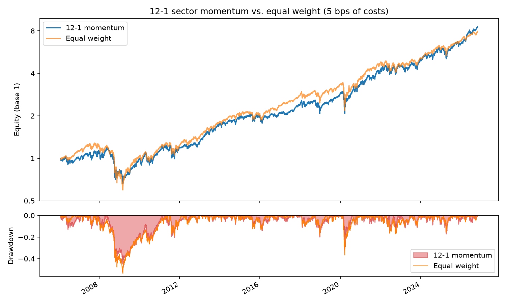

# quant-backtester

Vectorized backtesting engine in Python for quantitative strategies, focused on methodological
rigor: no look-ahead bias, transaction costs included, and out-of-sample validation.

> 🚧 Work in progress. See [docs/ROADMAP.md](docs/ROADMAP.md).

## What it does
- Turns a strategy (prices → portfolio weights) into a series of net returns
- Applies the decisions made at the close of *t* to the returns of *t+1*, so there is no look-ahead by construction
- Deducts costs proportional to turnover
- Computes CAGR, volatility, Sharpe, Sortino, max drawdown, Calmar and turnover
- Daily, weekly or monthly rebalancing

## Strategies
| Strategy | Status |
|---|---|
| 12-1 cross-sectional momentum (long-only / long-short) | ✅ |
| Mean reversion | ⏳ |
| Pairs trading (cointegration) | ⏳ |
| Time-series trend following | ⏳ |

## Installation
```bash
git clone https://github.com/paablomorillo/quant-backtester.git
cd quant-backtester
python -m venv .venv && source .venv/bin/activate   # Windows: .venv\Scripts\activate
pip install -e ".[dev]"
```

## Quick start
```python
from backtester import ProportionalCosts, run_backtest, summary
from backtester.data import load_prices
from backtester.strategies import CrossSectionalMomentum

prices = load_prices(
    ["XLB", "XLE", "XLF", "XLI", "XLK", "XLP", "XLU", "XLV", "XLY"], start="2005-01-01"
)
result = run_backtest(
    prices, CrossSectionalMomentum(top_n=3), ProportionalCosts(bps=5), rebalance="ME"
)
print(summary(result))
```

Or directly: `python examples/run_momentum.py`

## Results
12-1 momentum on 9 S&P 500 sector ETFs (top 3, monthly rebalancing) against the equal-weight
portfolio of the same 9 sectors, also rebalanced monthly and with 5 bps of costs.
Period: 2006-02-01 to 2026-10-30.



| | Momentum 0 bps | Momentum 5 bps | Momentum 20 bps | Equal weight |
|---|---|---|---|---|
| CAGR | 11.2% | 10.9% | 10.0% | 10.5% |
| Annual volatility | 18.8% | 18.8% | 18.8% | 18.3% |
| Sharpe | 0.66 | 0.64 | 0.60 | 0.64 |
| Sortino | 0.93 | 0.91 | 0.85 | 0.89 |
| Max drawdown | −44.9% | −45.0% | −45.2% | −53.5% |
| Calmar | 0.25 | 0.24 | 0.22 | 0.20 |
| Annual turnover | 5.2 | 5.2 | 5.2 | 0.3 |

**Sector momentum does not beat equal weight by any meaningful margin.** With 5 bps of costs the
Sharpe is the same (0.64) and with 20 bps it falls behind. It wins 10 of 21 years, and the edge
is concentrated in four of them (2026, 2022, 2008 and 2020); the other 17, taken together,
subtract. The max drawdown is 8.5 points smaller, but that is a single episode (2008). A *buy & hold* of the 9 sectors, never rebalanced, does the
same as equal weight: 10.5% CAGR and a Sharpe of 0.65.

The engine models weight drift between rebalances: nothing is traded in between, and going back
to the target pays costs. An earlier version rebalanced every day at no cost and gave slightly
better figures for both portfolios (11.0% and 10.7% CAGR, Sharpe 0.65 for both); the conclusion
is the same. Statistical significance is still to be measured (phase 3).

Full analysis, data checks and interpretation in
[notebooks/01_sector_momentum.ipynb](notebooks/01_sector_momentum.ipynb).

## Tests
```bash
pytest
```
Besides the unit tests for the metrics, there are specific tests against look-ahead bias:
changing future prices cannot change past weights, and a strategy that "buys what went up
today" cannot win on a random walk.

## Structure
```
src/backtester/
├── data.py          # download + cache + synthetic data
├── strategy.py      # Strategy interface
├── strategies/      # one strategy per file
├── engine.py        # run_backtest
├── costs.py         # cost models
├── metrics.py       # performance and risk metrics
└── report.py        # plots and comparisons
tests/               # pytest, no network
examples/            # runnable scripts
notebooks/           # analyses and demos
docs/ROADMAP.md      # phased plan
```

## License
MIT
