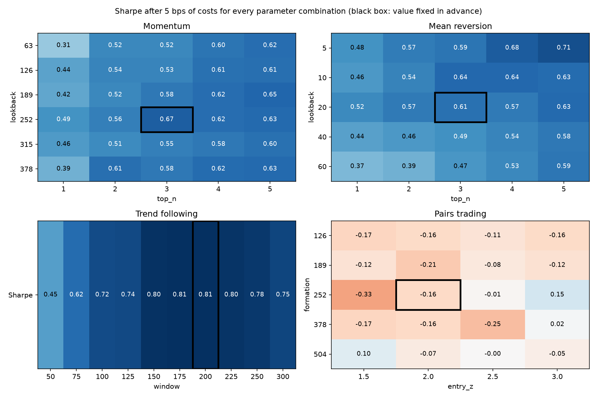

# quant-backtester

Vectorized backtesting engine in Python for quantitative strategies, focused on methodological
rigor: no look-ahead bias, transaction costs included, and out-of-sample validation.

> 🚧 Work in progress. See [docs/ROADMAP.md](docs/ROADMAP.md).

## What it does
- Turns a strategy (prices → portfolio weights) into a series of net returns
- Applies the decisions made at the close of *t* to the returns of *t+1*, so there is no look-ahead by construction
- Deducts costs proportional to turnover
- Computes CAGR, volatility, Sharpe, Sortino, max drawdown, Calmar and turnover
- Daily, weekly or monthly rebalancing
- Tests whether the Sharpe difference between two strategies is significant (paired stationary bootstrap and Ledoit-Wolf HAC test), with the Holm correction when several strategies are compared, and whether a single Sharpe ratio differs from zero (one-sample stationary bootstrap)
- Runs a strategy over a grid of parameter values and plots the Sharpe heatmap, to tell a plateau from an isolated spike
- Computes the Deflated Sharpe Ratio, which corrects the best Sharpe ratio for the number of configurations tried

## Strategies
| Strategy | Status |
|---|---|
| 12-1 cross-sectional momentum (long-only / long-short) | ✅ |
| Short-term mean reversion, price z-score (long-only / long-short) | ✅ |
| Time-series trend following (price above its moving average, else cash) | ✅ |
| Pairs trading (rolling Engle-Granger cointegration test, spread z-score) | ✅ |

## Installation
```bash
git clone https://github.com/paablomorillo/quant-backtester.git
cd quant-backtester
python -m venv .venv && source .venv/bin/activate   # Windows: .venv\Scripts\activate
pip install -e ".[dev]"
```

## Quick start
```python
from backtester import ProportionalCosts, run_backtest, summary
from backtester.data import load_prices
from backtester.strategies import CrossSectionalMomentum

prices = load_prices(
    ["XLB", "XLE", "XLF", "XLI", "XLK", "XLP", "XLU", "XLV", "XLY"], start="2005-01-01"
)
result = run_backtest(
    prices, CrossSectionalMomentum(top_n=3), ProportionalCosts(bps=5), rebalance="ME"
)
print(summary(result))
```

Or directly: `python examples/run_momentum.py`

## Results
12-1 momentum on 9 S&P 500 sector ETFs (top 3, monthly rebalancing) against the equal-weight
portfolio of the same 9 sectors, also rebalanced monthly and with 5 bps of costs.
Period: 2006-02-01 to 2026-10-30.


| | Momentum 0 bps | Momentum 5 bps | Momentum 20 bps | Equal weight |
|---|---|---|---|---|
| CAGR | 11.2% | 10.9% | 10.0% | 10.5% |
| Annual volatility | 18.8% | 18.8% | 18.8% | 18.3% |
| Sharpe | 0.66 | 0.64 | 0.60 | 0.64 |
| Sortino | 0.93 | 0.91 | 0.85 | 0.89 |
| Max drawdown | −44.9% | −45.0% | −45.2% | −53.5% |
| Calmar | 0.25 | 0.24 | 0.22 | 0.20 |
| Annual turnover | 5.2 | 5.2 | 5.2 | 0.3 |

**Sector momentum does not beat equal weight by any meaningful margin.** With 5 bps of costs the
Sharpe is the same (0.64) and with 20 bps it falls behind. It wins 10 of 21 years, and the edge
is concentrated in four of them (2026, 2022, 2008 and 2020); the other 17, taken together,
subtract. The max drawdown is 8.5 points smaller, but that is a single episode (2008). A *buy & hold* of the 9 sectors, never rebalanced, does the
same as equal weight: 10.5% CAGR and a Sharpe of 0.65.

The engine models weight drift between rebalances: nothing is traded in between, and going back
to the target pays costs. An earlier version rebalanced every day at no cost and gave slightly
better figures for both portfolios (11.0% and 10.7% CAGR, Sharpe 0.65 for both); the conclusion
is the same. The Sharpe difference (0.008) is not statistically significant: a paired stationary
bootstrap gives a 95% interval of about −0.17 to +0.14 (p = 0.92) and the Ledoit-Wolf HAC test
agrees (p = 0.93).

Full analysis, data checks and interpretation in
[notebooks/01_sector_momentum.ipynb](notebooks/01_sector_momentum.ipynb).

### Three strategies against equal weight
Momentum, mean reversion and trend following on the same 9 sector ETFs, all with 5 bps of costs
and monthly rebalancing, over the same period. Parameters were fixed before looking at the
results and each strategy was run once for this comparison (other parameter values are tried
later, in the robustness section).


| | 12-1 momentum | Mean reversion | Trend following | Equal weight |
|---|---|---|---|---|
| CAGR | 10.9% | 10.6% | 8.0% | 10.5% |
| Annual volatility | 18.8% | 20.0% | 10.4% | 18.3% |
| Sharpe | 0.64 | 0.60 | 0.80 | 0.64 |
| Max drawdown | −45.0% | −53.0% | −17.1% | −53.5% |
| Annual turnover | 5.2 | 15.7 | 1.9 | 0.3 |
| Sharpe difference vs. equal weight | +0.01 | −0.03 | +0.16 | |
| Bootstrap p-value (raw / Holm) | 0.92 / 1.00 | 0.57 / 1.00 | 0.32 / 0.96 | |

**None of the three beats equal weight in a way that can be told apart from luck.** Trend
following has the best Sharpe and a much smaller drawdown, but it is a different portfolio
rather than a better one: it is 75% invested on average, earns 2.5 points less per year, and
its advantage rests on one year (2008: −10.7% against −35.5%; without it the Sharpe ratios are
0.88 and 0.84). The 95% interval of its Sharpe difference is about −0.14 to +0.45. Mean reversion behaves like equal weight (correlation 0.93)
while turning the portfolio over about 16 times a year; monthly rebalancing is a poor setting for a 20-day signal.

Testing three strategies against the same benchmark is a multiple comparison, so the table shows
Holm-adjusted p-values next to the raw ones. The adjustment covers only these three tests, not
the earlier choices of universe and parameters.

Full analysis in
[notebooks/02_strategies_comparison.ipynb](notebooks/02_strategies_comparison.ipynb).

### Pairs trading on four pre-selected pairs
KO/PEP, XOM/CVX, GLD/GDX and EWA/EWC, chosen for their economic link before looking at any
result. Every 21 sessions the hedge ratio and an Engle-Granger cointegration test are
re-estimated on the last 252 closes; a pair is traded only while it passes the test. Entry at
|z| > 2, exit at |z| < 0.5, stop at |z| > 4, at most 63 sessions per trade, 5 bps of costs.
Parameters fixed in advance, one run for this result (other values are tried later, in the
robustness section). Period: 2007-05-22 to 2026-10-30.


| | KO/PEP | XOM/CVX | GLD/GDX | EWA/EWC | All pairs |
|---|---|---|---|---|---|
| Share of days tradable | 7.3% | 7.7% | 11.2% | 9.0% | |
| Share of days in a trade | 2.9% | 1.8% | 3.1% | 1.9% | 9.6% |
| Trades | 7 | 8 | 11 | 7 | 33 |
| Sharpe before costs | 0.22 | 0.26 | −0.17 | −0.04 | 0.08 |
| Sharpe after costs | 0.19 | 0.21 | −0.21 | −0.08 | 0.00 |
| Max drawdown | −2.8% | −3.0% | −9.7% | −4.5% | −10.0% |
| Bootstrap p-value vs. zero (raw / Holm) | 0.17 / 0.83 | 0.39 / 1.00 | 0.39 / 1.00 | 0.68 / 1.00 | 1.00 / 1.00 |

**The strategy earns nothing, mostly because it barely trades.** Each pair passes the
cointegration test on a one-year window 7% to 11% of the time, close to the 5% that two
unrelated random walks pass by chance, and the portfolio is in cash more than 90% of the days.
Of the 33 trades, 18 are closed because the pair stops passing the test and only 11 reach their
target. The Sharpe of the four pairs together is 0.00 after costs (95% interval about −0.43 to
+0.46) and no single pair is distinguishable from zero.

The benchmark is cash, not equal weight: the strategy is long one leg and short the other, so
the question is whether its Sharpe ratio differs from zero. This is not evidence that the pairs
are not cointegrated, because the test has low power on 252 observations. It says that this
filter, with this window, cannot tell them from unrelated pairs most of the time. The pairs are
textbook examples, which favours the strategy, and borrowing costs are not modelled.

Full analysis in [notebooks/03_pairs_trading.ipynb](notebooks/03_pairs_trading.ipynb).

### Robustness: parameter sensitivity and the Deflated Sharpe Ratio
The results above use parameters fixed in advance. This section asks whether they depend on those
exact values, and whether the best configuration found in the whole project survives a correction
for the number of configurations tried. Same data, 5 bps of costs, monthly rebalancing (none for
pairs trading). The grids are a diagnostic: nothing is re-tuned and the headline results stay
those of the pre-fixed parameters. Sector grids run from 2006-08-01 and the pairs grid from
2008-05-21, a few months later than above, so that every cell of a grid covers the same days.



| | Momentum | Mean reversion | Trend following | Pairs trading |
|---|---|---|---|---|
| Grid | lookback × top_n | lookback × top_n | window | formation × entry z |
| Sharpe of the pre-fixed parameters | 0.67 | 0.61 | 0.81 | −0.16 |
| Rank in the grid | 1 of 30 | 7 of 25 | 2 of 10 | 15 of 20 |
| Mean of the neighbouring cells | 0.58 | 0.57 | 0.81 | −0.18 |
| Grid median | 0.58 | 0.57 | 0.77 | −0.12 |
| Benchmark over the same period | 0.64 | 0.64 | 0.64 | 0 (cash) |
| Shape | Local peak on a flat surface | Smooth slope, no peak | Plateau | Noise around zero |

- **Trend following sits on a plateau**: any window from 150 to 250 sessions gives 0.78 to 0.81.
- **Momentum's pre-fixed parameters were the luckiest cell of their grid.** 28 of the 30
  combinations are below equal weight, so "momentum matches equal weight" was the favourable
  reading; a typical momentum configuration on these sectors is slightly behind it.
- **Mean reversion and pairs trading have no parameter set that rescues them**: 23 of 25 mean
  reversion cells are below equal weight and 17 of 20 pairs cells are below zero.

**98 configurations have been looked at in this project**: 85 grid cells (which include the four
pre-fixed ones), 9 other runs in notebooks 01 and 03, and 4 on an earlier version of the engine.
The best of them is trend following with a 175-day window, with a Sharpe of 0.81. Its Deflated
Sharpe Ratio (Bailey & López de Prado, 2014) is the probability that its true Sharpe ratio is
above what the best of that many skill-less strategies would be expected to show; 0.95 is the
usual bar.

| Deflated Sharpe Ratio of the best configuration | Trials | Expected best Sharpe with no skill | Sharpe of the best | DSR |
|---|---|---|---|---|
| Against cash, all trials as if independent | 98 | 0.79 | 0.81 | 0.54 |
| Against cash, effective number of trials | 51 | 0.72 | 0.81 | 0.67 |
| Against cash, sector trials only | 73 | 0.26 | 0.81 | 0.99 |
| Against equal weight, sector trials | 70 | 0.36 | 0.35 | 0.48 |
| Against equal weight, effective number of trials | 51 | 0.34 | 0.35 | 0.52 |

**No configuration survives the correction.** Counting every trial, the best Sharpe ratio is a
coin flip against the best of 98 lucky draws. The 0.99 of the third row is not a contradiction:
it measures against zero, and every sector trial is a long-only equity portfolio in 20 years in
which equal weight alone earned 0.64. It says that owning equities paid. Against equal weight,
which is the question asked throughout, the best of 70 sector trials (mean reversion with a 5-day
lookback holding 5 sectors) has a DSR of about 0.5: what luck alone would produce.

The DSR assumes independent trials of the same kind; here they are correlated within a grid and
come from different strategies and two universes, which is why the first three rows differ so
much. The count covers what was run in this repository, not the earlier choices of universe and
strategy families.

Full analysis in [notebooks/04_robustness.ipynb](notebooks/04_robustness.ipynb).

## Tests
```bash
pytest
```
Besides the unit tests for the metrics, there are specific tests against look-ahead bias:
changing future prices cannot change past weights, and a strategy that "buys what went up
today" cannot win on a random walk.

## Structure
```
src/backtester/
├── data.py          # download + cache + synthetic data
├── strategy.py      # Strategy interface
├── strategies/      # one strategy per file
├── engine.py        # run_backtest
├── costs.py         # cost models
├── metrics.py       # performance and risk metrics
├── significance.py  # bootstrap and Ledoit-Wolf tests, Holm correction, Deflated Sharpe Ratio
├── sensitivity.py   # one backtest per combination of a parameter grid
└── report.py        # plots, Sharpe heatmaps and comparisons
tests/               # pytest, no network
examples/            # runnable scripts
notebooks/           # analyses and demos
docs/ROADMAP.md      # phased plan
```

## License
MIT
