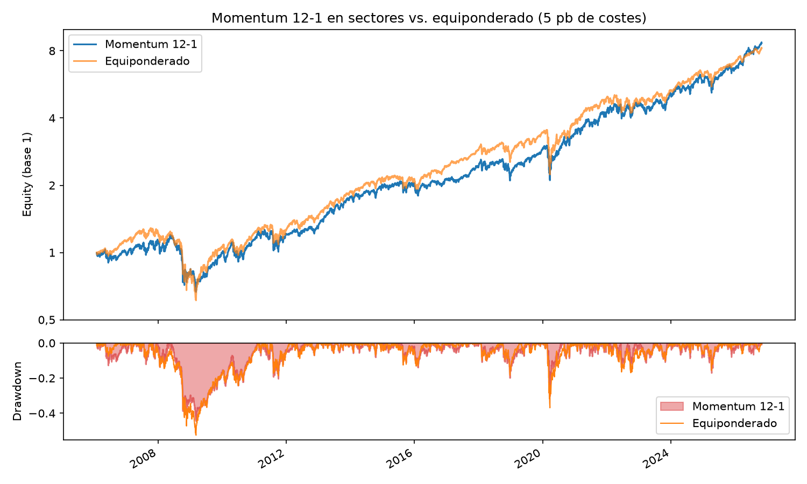

# quant-backtester

Motor de backtesting vectorizado en Python para estrategias cuantitativas, centrado en el rigor
metodológico: sin look-ahead bias, con costes de transacción y con validación fuera de muestra.

> 🚧 En desarrollo. Ver [docs/ROADMAP.md](docs/ROADMAP.md).

## Qué hace
- Convierte una estrategia (precios → pesos de cartera) en una serie de rendimientos netos
- Aplica las decisiones del cierre de *t* a los rendimientos de *t+1*, así que no hay look-ahead por construcción
- Descuenta costes proporcionales al turnover
- Calcula CAGR, volatilidad, Sharpe, Sortino, max drawdown, Calmar y turnover
- Rebalanceo diario, semanal o mensual

## Estrategias
| Estrategia | Estado |
|---|---|
| Momentum de sección cruzada 12-1 (long-only / long-short) | ✅ |
| Mean reversion | ⏳ |
| Pairs trading (cointegración) | ⏳ |
| Trend following por series temporales | ⏳ |

## Instalación
```bash
git clone https://github.com/paablomorillo/quant-backtester.git
cd quant-backtester
python -m venv .venv && source .venv/bin/activate   # Windows: .venv\Scripts\activate
pip install -e ".[dev]"
```

## Uso rápido
```python
from backtester import ProportionalCosts, run_backtest, summary
from backtester.data import load_prices
from backtester.strategies import CrossSectionalMomentum

prices = load_prices(
    ["XLB", "XLE", "XLF", "XLI", "XLK", "XLP", "XLU", "XLV", "XLY"], start="2005-01-01"
)
result = run_backtest(
    prices, CrossSectionalMomentum(top_n=3), ProportionalCosts(bps=5), rebalance="ME"
)
print(summary(result))
```

O directamente: `python examples/run_momentum.py`

## Resultados
Momentum 12-1 sobre 9 ETFs sectoriales del S&P 500 (top 3, rebalanceo mensual) frente a la
cartera equiponderada de los mismos 9 sectores, reequilibrada también cada mes y con 5 pb de
costes. Periodo: 2006-02-01 a 2026-10-30.



| | Momentum 0 pb | Momentum 5 pb | Momentum 20 pb | Equiponderado |
|---|---|---|---|---|
| CAGR | 11,2 % | 10,9 % | 10,0 % | 10,5 % |
| Volatilidad anual | 18,8 % | 18,8 % | 18,8 % | 18,3 % |
| Sharpe | 0,66 | 0,64 | 0,60 | 0,64 |
| Sortino | 0,93 | 0,91 | 0,85 | 0,89 |
| Max drawdown | −44,9 % | −45,0 % | −45,2 % | −53,5 % |
| Calmar | 0,25 | 0,24 | 0,22 | 0,20 |
| Turnover anual | 5,2 | 5,2 | 5,2 | 0,3 |

**El momentum sectorial no bate al equiponderado de forma apreciable.** Con 5 pb de costes el
Sharpe es el mismo (0,64) y con 20 pb queda por debajo. Gana 10 de 21 años, y la ventaja se
concentra en tres (2008, 2022 y 2026). La caída máxima es 8,5 puntos menor, pero es un solo
episodio (2008). Un *buy & hold* de los 9 sectores, sin reequilibrar nunca, da lo mismo que el
equiponderado: 10,5 % de CAGR y Sharpe 0,65.

El motor modela la deriva de pesos entre rebalanceos: no se opera entre medias y volver al
objetivo paga costes. Una versión anterior reequilibraba cada día sin coste y daba cifras algo
mejores en ambas carteras (11,0 % y 10,7 % de CAGR, Sharpe 0,65 en las dos); la conclusión es la
misma. Falta medir la significación estadística (fase 3).

Análisis completo, revisión de datos e interpretación en
[notebooks/01_momentum_sectores.ipynb](notebooks/01_momentum_sectores.ipynb).

## Tests
```bash
pytest
```
Además de los tests unitarios de métricas, hay tests específicos contra el look-ahead bias:
modificar precios futuros no puede cambiar los pesos pasados, y una estrategia que "compra lo
que ha subido hoy" no puede ganar en un paseo aleatorio.

## Estructura
```
src/backtester/
├── data.py          # descarga + caché + datos sintéticos
├── strategy.py      # interfaz Strategy
├── strategies/      # una estrategia por fichero
├── engine.py        # run_backtest
├── costs.py         # modelos de costes
├── metrics.py       # métricas de rendimiento y riesgo
└── report.py        # gráficas y comparativas
tests/               # pytest, sin red
examples/            # scripts ejecutables
notebooks/           # análisis y demos
docs/ROADMAP.md      # plan por fases
```

## Licencia
MIT
