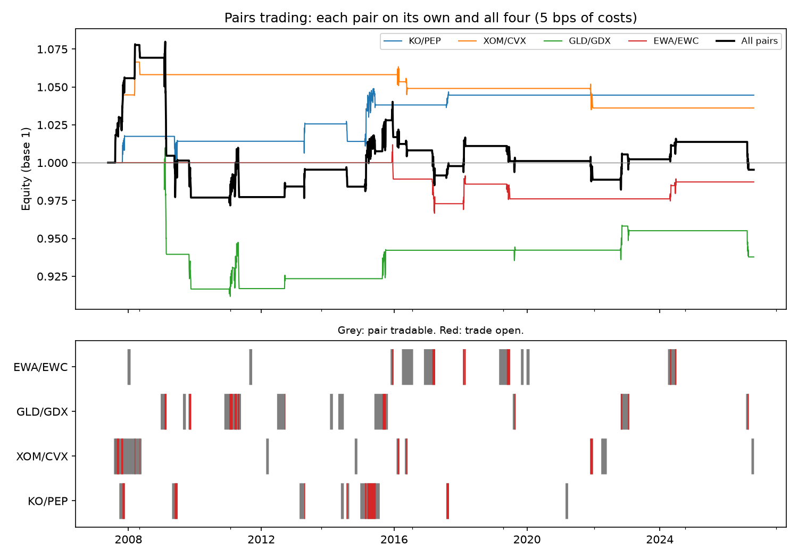
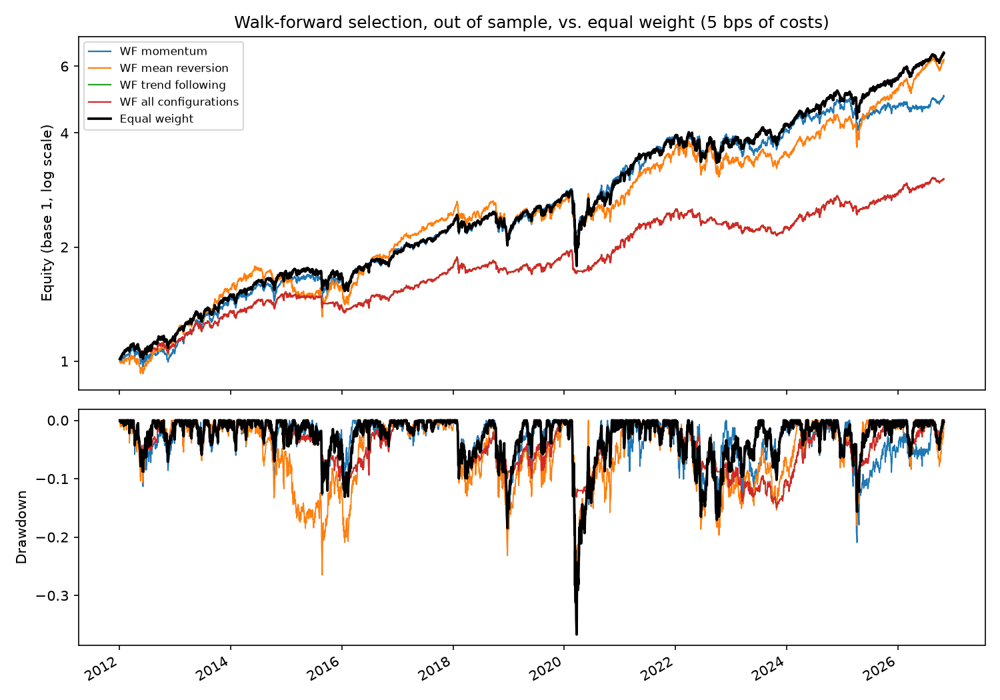

# quant-backtester

A vectorized backtesting engine in Python, and a five-notebook study that uses it to ask one
question honestly: **do four textbook quantitative strategies beat doing nothing clever?**
They do not, and this README shows how that was established.

## Key findings

- **Sector momentum ties with equal weight.** 12-1 momentum on 9 S&P 500 sector ETFs has a
  Sharpe ratio of 0.64 after 5 bps of costs, against 0.64 for the equal-weight portfolio of the
  same sectors (2006-2026). The difference is 0.008, with a bootstrap p-value of 0.92.
- **No sector strategy beats equal weight after correcting for multiple tests.** Trend following
  has the best Sharpe (0.80) and a max drawdown of −17% against −54%, but it is 75% invested on
  average, earns 8.0% a year against 10.5%, and its edge rests on 2008. Holm-adjusted p-values
  are all above 0.9.
- **Pairs trading earns nothing.** Four pre-selected pairs have a combined Sharpe of 0.00 after
  costs. Each pair passes the cointegration filter on only 7% to 11% of days, close to the 5%
  that unrelated random walks pass by chance.
- **The best configuration ever run does not survive the Deflated Sharpe Ratio.** Counting all
  98 configurations tried up to that point, the best one (Sharpe 0.81) has a DSR of 0.54,
  against the usual bar of 0.95. Measured against equal weight, the best DSR is about 0.5.
- **Choosing parameters in real time does worse than not choosing.** Out of sample (2012-2026),
  walk-forward selection gives Sharpe ratios of 0.74 to 0.84, below equal weight (0.89). The
  configuration with the best track record lands the next year in the middle of its own grid.

Every headline parameter was fixed before looking at results, and the negative results are
reported as they came out.

## The research arc

Each notebook answers one question and motivates the next. All use 5 bps of costs per unit of
turnover and data up to 2026-10-30.

### 01 · Does sector momentum beat equal weight?
[notebooks/01_sector_momentum.ipynb](notebooks/01_sector_momentum.ipynb)

Each month, buy the 3 sectors with the best 12-1 return. With 5 bps of costs it earns 10.9% a
year against 10.5% for equal weight, with the same Sharpe (0.64); with 20 bps it falls behind
(0.60). It wins 10 of 21 years. A paired stationary bootstrap puts the Sharpe difference between
about −0.17 and +0.14, and the Ledoit-Wolf test agrees (p = 0.93).


### 02 · Does any of three classic strategies?
[notebooks/02_strategies_comparison.ipynb](notebooks/02_strategies_comparison.ipynb)

Momentum, mean reversion and trend following on the same sectors, each run once. Their Sharpe
ratios are 0.64, 0.60 and 0.80, against 0.64 for equal weight. Trend following looks best, but
the 95% interval of its Sharpe difference runs from about −0.14 to +0.45 (p = 0.32, 0.96 after
Holm), and without 2008 the gap almost closes (0.88 against 0.84). It is a different portfolio,
not a better one.


### 03 · Does pairs trading earn anything against cash?
[notebooks/03_pairs_trading.ipynb](notebooks/03_pairs_trading.ipynb)

KO/PEP, XOM/CVX, GLD/GDX and EWA/EWC, traded only while a rolling Engle-Granger test supports
the pair. The portfolio has a trade open on 9.6% of days and makes 33 trades in 19 years; 18 of
them close because the pair stops passing the test, and only 11 reach their target. The Sharpe
is 0.00 after costs (95% interval about −0.43 to +0.46). The benchmark is cash, because the
strategy is market-neutral.



### 04 · Do the results depend on the parameters, and does the best one survive?
[notebooks/04_robustness.ipynb](notebooks/04_robustness.ipynb)

Sharpe grids over 85 parameter combinations. Trend following sits on a plateau (0.78 to 0.81 for
any window from 150 to 250 sessions). Momentum's pre-fixed parameters turn out to be the best
cell of 30, and 28 of the 30 are below equal weight, so the "tie" of notebook 01 was the
favourable reading. For pairs trading, 17 of 20 cells are below zero. The best of the 98
configurations counted has a Deflated Sharpe Ratio of 0.54 (0.67 with the effective number of
trials), and against equal weight the best of 70 sector trials has 0.48.


### 05 · What if the parameters had been chosen in real time?
[notebooks/05_walk_forward.ipynb](notebooks/05_walk_forward.ipynb)

At the end of each year, the configuration with the best Sharpe ratio so far is traded the
following year. Out of sample, the walk-forward portfolios reach 0.74 (momentum), 0.81 (mean
reversion) and 0.84 (trend following), against 0.88, 0.83 and 0.93 for the parameters fixed in
advance and 0.89 for equal weight. No difference is significant after Holm. The chosen
configuration lands, on average, at the 51st to 59th percentile of its grid the next year: past
Sharpe ratio says nothing usable about which parameters will do better. With these runs the
project has tried 106 configurations.



## Methodology highlights

- **No look-ahead by construction.** A strategy at row *t* sees prices up to the close of *t*,
  and the engine applies its weights to the return of *t+1*. Every strategy has a test that
  changing future prices leaves past weights unchanged, and a strategy that "buys what went up
  today" cannot win on a random walk.
- **Weight drift.** Between rebalances nothing is traded and weights drift with prices. Turnover
  is measured against the drifted weights, so rebalancing costs money even when the target does
  not change. A row with no order (all NaN) means "do not trade".
- **Costs.** Proportional to turnover, 5 bps throughout, with 0 and 20 bps as a sensitivity
  check. Walk-forward switches go through the engine and pay their turnover.
- **Paired bootstrap and Ledoit-Wolf.** Sharpe differences are tested on paired daily returns
  with a stationary bootstrap (10,000 replicates, automatic block length, fixed seed) and
  cross-checked with the Ledoit-Wolf HAC test, which shares no machinery with it.
- **Holm correction** whenever several strategies face the same benchmark.
- **Deflated Sharpe Ratio with an honest trial count.** Every configuration whose performance
  was seen is counted, including benchmarks and four runs on an earlier engine version that can
  no longer be reproduced.
- **Walk-forward validation.** Yearly selection on an expanding window of past data only, with
  the design written down before running it.

Code: [engine.py](src/backtester/engine.py), [significance.py](src/backtester/significance.py),
[sensitivity.py](src/backtester/sensitivity.py), [walk_forward.py](src/backtester/walk_forward.py).

## Limitations

- **Selection of the universe and of the menu.** The 9 sector ETFs exist today, the four pairs
  are textbook examples, and the strategy families come from a literature that reports what
  worked. The parameter grids were designed after seeing the full sample. The trial count covers
  what was run here, not those earlier choices.
- **Cash earns 0** and the risk-free rate is 0, which understates the return of the strategies
  that sit partly in cash.
- **No borrowing costs** for short positions, and no spread or market impact beyond the 5 bps.
- **Yahoo adjusted prices are recomputed with every dividend**, so a later download can shift
  the numbers slightly.
- **One history.** The full sample has one slow bear market (2008), and the walk-forward
  out-of-sample period (2012-2026) has none.
- **The Deflated Sharpe Ratio assumes independent trials.** Here they are correlated, so it
  should be read as a range (0.54 to 0.99 against cash, depending on which trials are counted).

## Reproducibility

```bash
git clone https://github.com/paablomorillo/quant-backtester.git
cd quant-backtester
python -m venv .venv && source .venv/bin/activate   # Windows: .venv\Scripts\activate
pip install -e ".[dev]"
pytest
```

- **Data.** Prices are downloaded from Yahoo Finance on the first run and cached as parquet
  files in `data/`. The cache is not in the repository, so a fresh clone downloads its own copy.
- **Fixed end date.** Every notebook requests data up to 2026-10-31, so the sample does not grow
  over time. The numbers in this README come from the outputs stored in the notebooks.
- **Fixed seeds.** The bootstrap tests use `seed=0`.
- **Run order.** 01 to 05. Each notebook loads its own data and can be run alone; the order is
  the order of the argument.

| Notebook | Approximate runtime |
|---|---|
| 01 Sector momentum | 30 s |
| 02 Strategies comparison | 20 s |
| 03 Pairs trading | 1 min |
| 04 Robustness | 3 min |
| 05 Walk-forward | 2 min |

Measured on a laptop with the data already cached. The tests use synthetic data and need no
network.

## Quick start

```python
from backtester import ProportionalCosts, run_backtest, summary
from backtester.data import load_prices
from backtester.strategies import CrossSectionalMomentum

prices = load_prices(
    ["XLB", "XLE", "XLF", "XLI", "XLK", "XLP", "XLU", "XLV", "XLY"], start="2005-01-01"
)
result = run_backtest(
    prices, CrossSectionalMomentum(top_n=3), ProportionalCosts(bps=5), rebalance="ME"
)
print(summary(result))
```

Or directly: `python examples/run_momentum.py` (add `--synthetic` to run without internet).

## Structure

```
src/backtester/
├── data.py          # download + cache + synthetic data
├── strategy.py      # Strategy interface
├── strategies/      # momentum, mean reversion, trend following, pairs trading
├── engine.py        # run_backtest
├── costs.py         # cost models
├── metrics.py       # performance and risk metrics
├── significance.py  # bootstrap and Ledoit-Wolf tests, Holm correction, Deflated Sharpe Ratio
├── sensitivity.py   # one backtest per combination of a parameter grid
├── walk_forward.py  # yearly selection on past data, traded out of sample
└── report.py        # plots, Sharpe heatmaps and comparisons
tests/               # pytest, no network
notebooks/           # the five analyses
docs/ROADMAP.md      # what was done and future work
```

## How this was built

I built this project with Claude Code as a pair programmer; most of the code was written by it.
My role was to run the research: I chose the questions each notebook answers, set the project's
ground rules (no look-ahead by construction, tests before code, parameters fixed before seeing
results, negative results reported as they are) and reviewed every plan before any code was
written. Several key design decisions came out of that review: how weight drift interacts with
rebalancing, treating an all-NaN row as "no order", using cash rather than equal weight as the
benchmark for the market-neutral pairs strategy, and counting every configuration ever run,
including irreproducible ones, for the Deflated Sharpe Ratio. Every change went through tests,
an independent code review and CI before reaching main.

## License
MIT
