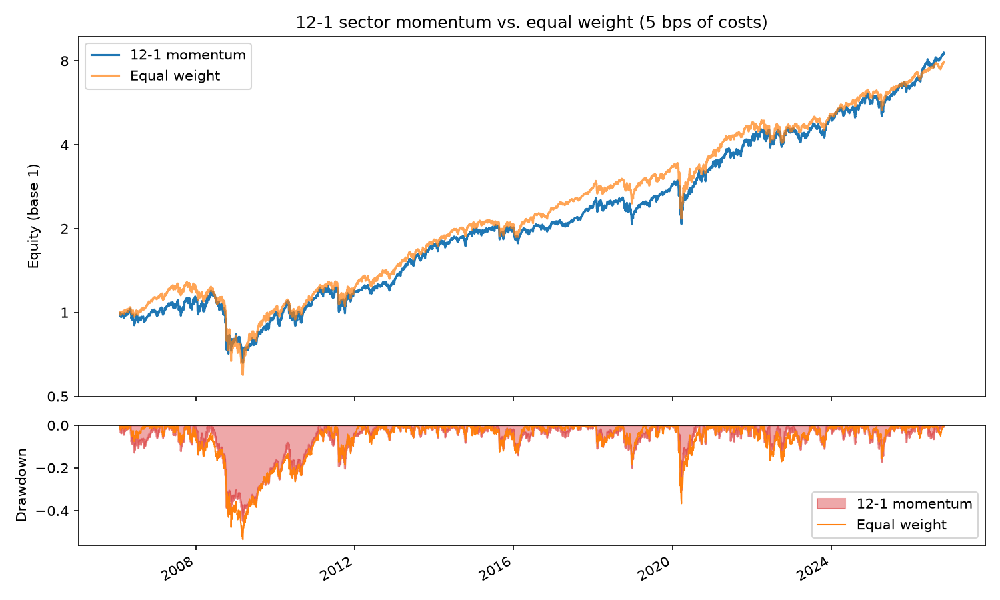
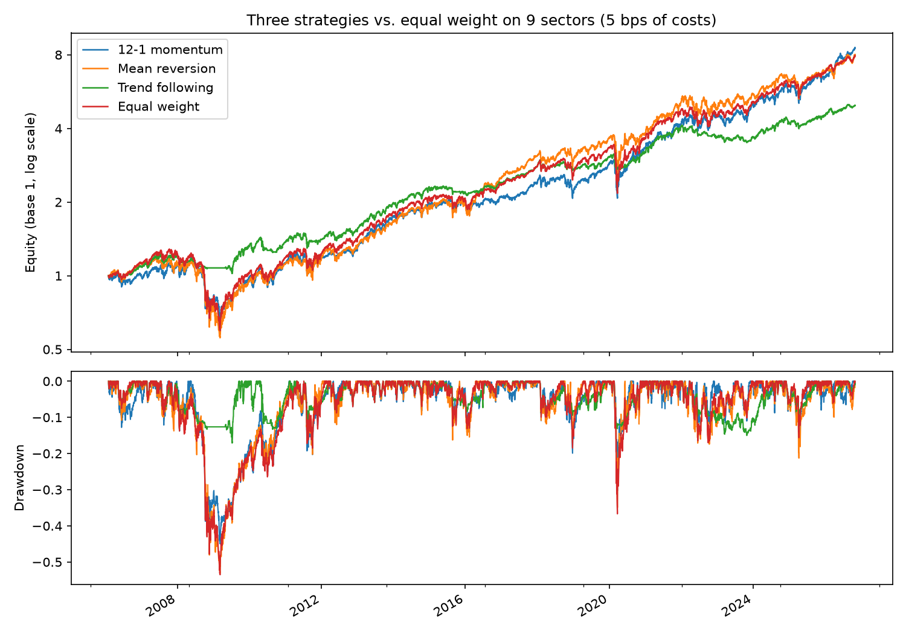

# quant-backtester

Vectorized backtesting engine in Python for quantitative strategies, focused on methodological
rigor: no look-ahead bias, transaction costs included, and out-of-sample validation.

> 🚧 Work in progress. See [docs/ROADMAP.md](docs/ROADMAP.md).

## What it does
- Turns a strategy (prices → portfolio weights) into a series of net returns
- Applies the decisions made at the close of *t* to the returns of *t+1*, so there is no look-ahead by construction
- Deducts costs proportional to turnover
- Computes CAGR, volatility, Sharpe, Sortino, max drawdown, Calmar and turnover
- Daily, weekly or monthly rebalancing
- Tests whether the Sharpe difference between two strategies is significant (paired stationary bootstrap and Ledoit-Wolf HAC test), with the Holm correction when several strategies are compared

## Strategies
| Strategy | Status |
|---|---|
| 12-1 cross-sectional momentum (long-only / long-short) | ✅ |
| Short-term mean reversion, price z-score (long-only / long-short) | ✅ |
| Time-series trend following (price above its moving average, else cash) | ✅ |
| Pairs trading (cointegration) | ⏳ |

## Installation
```bash
git clone https://github.com/paablomorillo/quant-backtester.git
cd quant-backtester
python -m venv .venv && source .venv/bin/activate   # Windows: .venv\Scripts\activate
pip install -e ".[dev]"
```

## Quick start
```python
from backtester import ProportionalCosts, run_backtest, summary
from backtester.data import load_prices
from backtester.strategies import CrossSectionalMomentum

prices = load_prices(
    ["XLB", "XLE", "XLF", "XLI", "XLK", "XLP", "XLU", "XLV", "XLY"], start="2005-01-01"
)
result = run_backtest(
    prices, CrossSectionalMomentum(top_n=3), ProportionalCosts(bps=5), rebalance="ME"
)
print(summary(result))
```

Or directly: `python examples/run_momentum.py`

## Results
12-1 momentum on 9 S&P 500 sector ETFs (top 3, monthly rebalancing) against the equal-weight
portfolio of the same 9 sectors, also rebalanced monthly and with 5 bps of costs.
Period: 2006-02-01 to 2026-10-30.



| | Momentum 0 bps | Momentum 5 bps | Momentum 20 bps | Equal weight |
|---|---|---|---|---|
| CAGR | 11.2% | 10.9% | 10.0% | 10.5% |
| Annual volatility | 18.8% | 18.8% | 18.8% | 18.3% |
| Sharpe | 0.66 | 0.64 | 0.60 | 0.64 |
| Sortino | 0.93 | 0.91 | 0.85 | 0.89 |
| Max drawdown | −44.9% | −45.0% | −45.2% | −53.5% |
| Calmar | 0.25 | 0.24 | 0.22 | 0.20 |
| Annual turnover | 5.2 | 5.2 | 5.2 | 0.3 |

**Sector momentum does not beat equal weight by any meaningful margin.** With 5 bps of costs the
Sharpe is the same (0.64) and with 20 bps it falls behind. It wins 10 of 21 years, and the edge
is concentrated in four of them (2026, 2022, 2008 and 2020); the other 17, taken together,
subtract. The max drawdown is 8.5 points smaller, but that is a single episode (2008). A *buy & hold* of the 9 sectors, never rebalanced, does the
same as equal weight: 10.5% CAGR and a Sharpe of 0.65.

The engine models weight drift between rebalances: nothing is traded in between, and going back
to the target pays costs. An earlier version rebalanced every day at no cost and gave slightly
better figures for both portfolios (11.0% and 10.7% CAGR, Sharpe 0.65 for both); the conclusion
is the same. The Sharpe difference (0.008) is not statistically significant: a paired stationary
bootstrap gives a 95% interval of about −0.17 to +0.14 (p = 0.92) and the Ledoit-Wolf HAC test
agrees (p = 0.93).

Full analysis, data checks and interpretation in
[notebooks/01_sector_momentum.ipynb](notebooks/01_sector_momentum.ipynb).

### Three strategies against equal weight
Momentum, mean reversion and trend following on the same 9 sector ETFs, all with 5 bps of costs
and monthly rebalancing, over the same period. Parameters were fixed before looking at the
results and each strategy was run once.



| | 12-1 momentum | Mean reversion | Trend following | Equal weight |
|---|---|---|---|---|
| CAGR | 10.9% | 10.6% | 8.0% | 10.5% |
| Annual volatility | 18.8% | 20.0% | 10.4% | 18.3% |
| Sharpe | 0.64 | 0.60 | 0.80 | 0.64 |
| Max drawdown | −45.0% | −53.0% | −17.1% | −53.5% |
| Annual turnover | 5.2 | 15.7 | 1.9 | 0.3 |
| Sharpe difference vs. equal weight | +0.01 | −0.03 | +0.16 | |
| Bootstrap p-value (raw / Holm) | 0.92 / 1.00 | 0.57 / 1.00 | 0.32 / 0.96 | |

**None of the three beats equal weight in a way that can be told apart from luck.** Trend
following has the best Sharpe and a much smaller drawdown, but it is a different portfolio
rather than a better one: it is 75% invested on average, earns 2.5 points less per year, and
its advantage rests on one year (2008: −10.7% against −35.5%; without it the Sharpe ratios are
0.88 and 0.84). The 95% interval of its Sharpe difference is about −0.14 to +0.45. Mean reversion behaves like equal weight (correlation 0.93)
while turning the portfolio over about 16 times a year; monthly rebalancing is a poor setting for a 20-day signal.

Testing three strategies against the same benchmark is a multiple comparison, so the table shows
Holm-adjusted p-values next to the raw ones. The adjustment covers only these three tests, not
the earlier choices of universe and parameters.

Full analysis in
[notebooks/02_strategies_comparison.ipynb](notebooks/02_strategies_comparison.ipynb).

## Tests
```bash
pytest
```
Besides the unit tests for the metrics, there are specific tests against look-ahead bias:
changing future prices cannot change past weights, and a strategy that "buys what went up
today" cannot win on a random walk.

## Structure
```
src/backtester/
├── data.py          # download + cache + synthetic data
├── strategy.py      # Strategy interface
├── strategies/      # one strategy per file
├── engine.py        # run_backtest
├── costs.py         # cost models
├── metrics.py       # performance and risk metrics
├── significance.py  # paired bootstrap and Ledoit-Wolf tests for Sharpe differences, Holm correction
└── report.py        # plots and comparisons
tests/               # pytest, no network
examples/            # runnable scripts
notebooks/           # analyses and demos
docs/ROADMAP.md      # phased plan
```

## License
MIT
